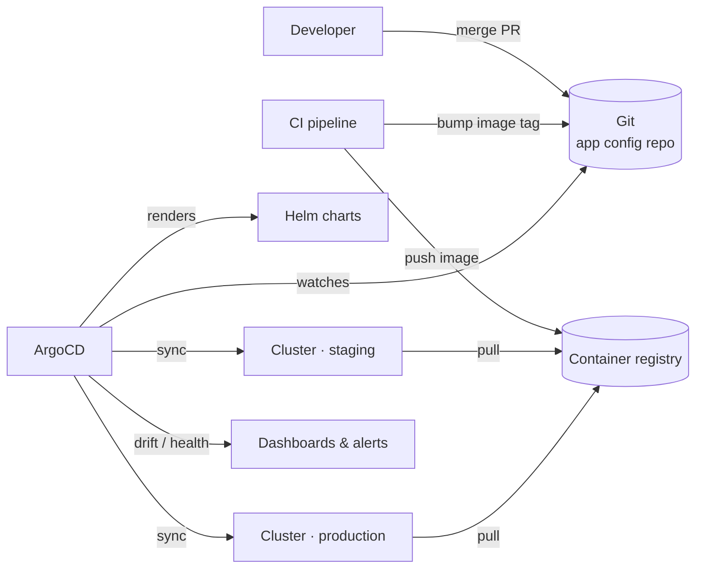

# GitOps Deployment Platform

 -lightgrey) 

> **Architecture write-up.** This documents a system I designed and built as a DevOps Engineer at Faclon Labs (Mumbai). The implementation belongs to my employer and is not published; what follows is the design, the moving parts and the outcomes, with internal names and details left out.

Kubernetes deployments standardised on Helm charts and ArgoCD: the desired
state of every environment lives in Git, ArgoCD keeps the clusters in sync
with it, every release is auditable, and rolling back is a one-command
revert.

## The problem

Deployments were imperative — someone running `kubectl`/`helm` from a
laptop. What was running could differ from what was in Git, and rolling back
depended on remembering what the previous state had been.

## Architecture

## How a release happens

1. CI builds and pushes an image, then commits the new tag to the config repo.
2. ArgoCD notices the commit, renders the Helm chart with that environment's
   values and compares it with the live cluster.
3. The difference is applied; health checks decide when the release is done.
4. A rollback is `git revert` — ArgoCD syncs the cluster back to the previous
   state.

## Design points

- **One chart, per-environment values** — the same artefact promotes from
  staging to production; only values differ.
- **Git is the audit log.** Who changed what, when, and the review that
  approved it, are the repository history.
- **Drift is visible**, and corrected automatically where that is safe.

## Outcomes

- Auditable, repeatable releases across environments.
- Automated synchronisation removed hand-run deployments.
- One-command rollbacks.

## Stack

ArgoCD · Helm · Kubernetes (EKS / AKS) · Git · container registry · Prometheus / Grafana

## My role

Introduced ArgoCD and Helm as the deployment layer, wrote the charts and
environment structure, and migrated the services onto it.
